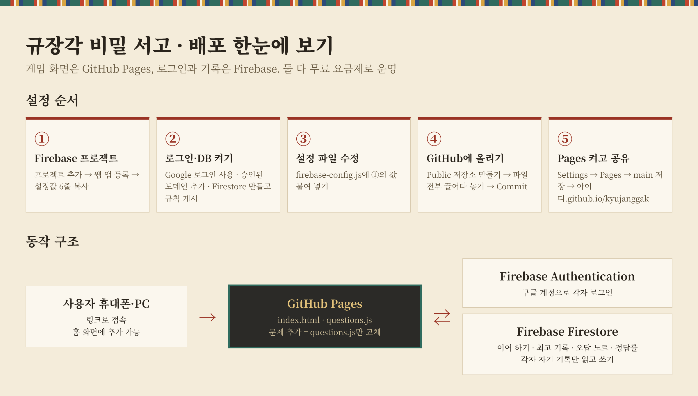
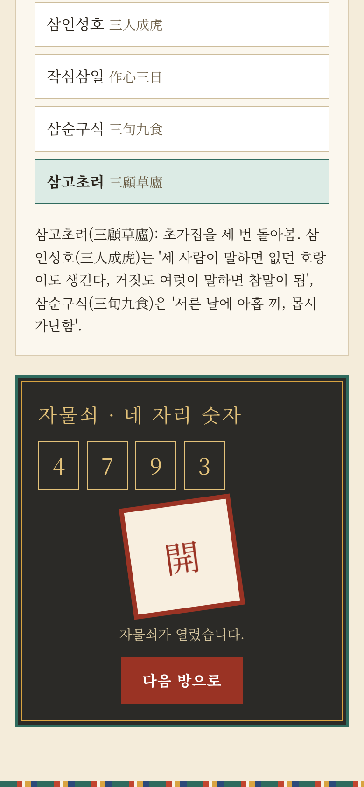
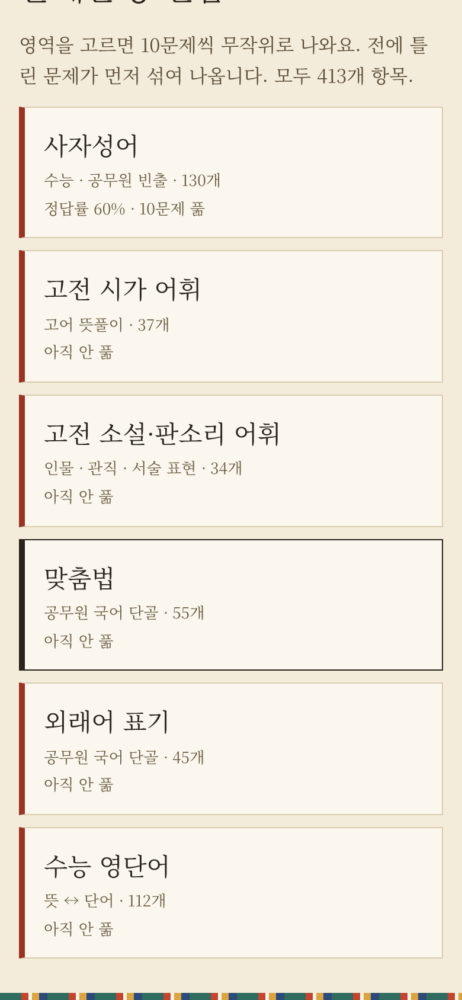
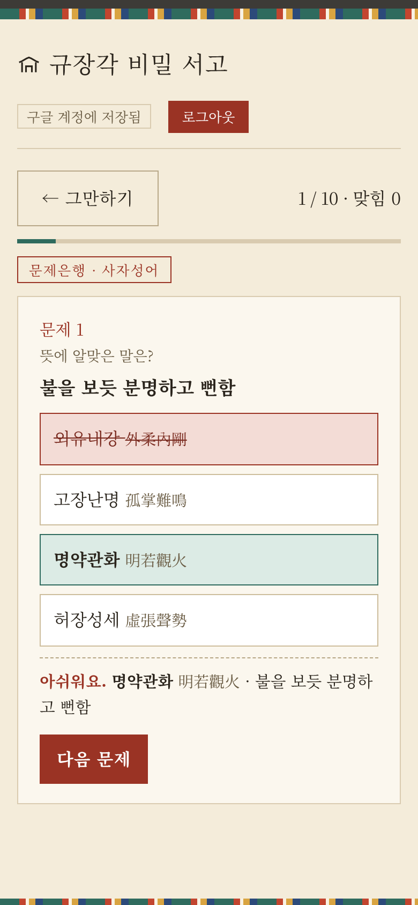
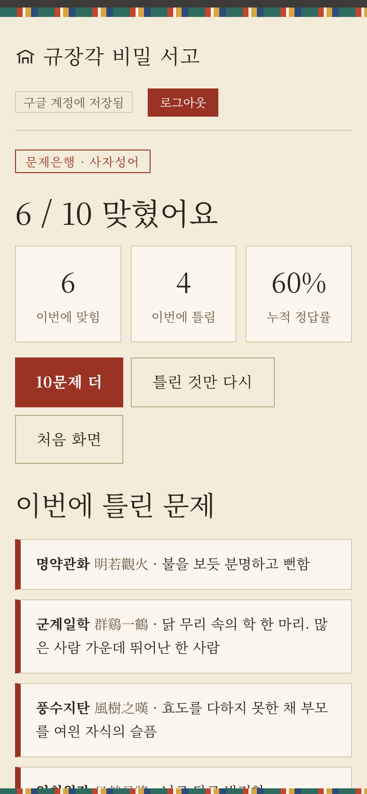

# 규장각 비밀 서고 · GitHub Pages + Firebase 판

수능·공무원 국어·영어 방탈출. 여러 사람이 각자 구글 계정으로 로그인해 기록(이어 하기, 최고 기록, 오답 노트, 정답률)을 남길 수 있는 버전입니다.

## 게임 화면 둘러보기

| 첫 화면 | 방탈출 | 자물쇠 열림 |
|:---:|:---:|:---:|
|  |  |  |
| 관 고르기(본관·사자성어관·고전 소설관·**오늘의 서고**), 이어 하기, 관별 최고 기록 | 문제를 풀면 단서가 찍힘. 틀린 보기는 줄이 그어짐 | 단서를 모아 현판 자물쇠를 열면 다음 방으로 |

| 문제은행 영역 | 문제은행 풀이 | 결과 |
|:---:|:---:|:---:|
|  |  |  |
| 6개 영역, 영역별 누적 정답률 | 10문제씩 무작위. 답하면 바로 해설 | 10문제 더 · 틀린 것만 다시 |

| 누적 오답 노트 |
|:---:|
|  |
| 틀린 문제를 모아 '오답 다시 풀기'로 복습. 맞히거나 '학습 완료'를 누르면 노트에서 빠짐 |

### 오늘의 서고 (무작위 관)

들어갈 때마다 문제은행에서 무작위로 20문제를 뽑아 방 5개를 새로 만듭니다.

| 방 | 영역 |
|---|---|
| 제1실 | 사자성어 |
| 제2실 | 고전 시가 어휘 |
| 제3실 | 고전 소설·판소리 어휘 |
| 제4실 | 맞춤법·외래어 표기 |
| 제5실 | 수능 영단어 |

- 정답의 첫 글자가 단서가 되고, 단서 네 글자를 순서대로 입력하면 자물쇠가 열립니다.
- 틀린 문제는 누적 오답 노트의 '문제은행' 항목에 쌓여 '오답 다시 풀기'로 복습할 수 있습니다.
- `questions.js`의 문제은행에 항목을 추가하면 오늘의 서고에도 자동으로 반영됩니다.

화면 왼쪽 위 **규장각 비밀 서고** 제목(집 모양 아이콘)을 누르면 언제든 처음 화면으로 돌아갑니다. 방탈출 도중이면 진행 상황이 저장되어 '이어 하기'로 계속할 수 있습니다.

화면 위쪽 **구글로 로그인**을 누르면 기록이 구글 계정에 저장되어 다른 기기에서도 이어집니다. 로그인하지 않으면 그 브라우저에만 저장됩니다.

## 파일

| 파일 | 내용 |
|---|---|
| `index.html` | 게임 화면과 기능 |
| `questions.js` | 문제 데이터 (방탈출 56문항 + 문제은행 413항목). **문제를 늘릴 때는 이 파일만 바꿈** |
| `firebase-config.js` | Firebase 설정값을 붙여 넣는 파일 (**꼭 수정**) |
| `firestore.rules` | 보안 규칙: 각자 자기 기록만 읽고 쓰게 함 |
| `manifest.json`, `icon-192.png`, `icon-512.png` | 휴대폰 홈 화면 추가용 앱 정보와 아이콘 |
| `docs/` | 이 안내서에 쓰인 화면 이미지 (게임 동작에는 필요 없음) |

## 1. Firebase 준비 (약 10분)

1. https://console.firebase.google.com 접속 → 구글 계정으로 로그인 → **프로젝트 추가**
   - 이름: `kyujanggak` (아무거나 가능) → Google 애널리틱스는 꺼도 됨 → 만들기
2. 프로젝트 첫 화면에서 **웹 앱 추가(`</>` 아이콘)** → 앱 닉네임 입력 → 'Firebase 호스팅 설정'은 체크하지 않음 → 앱 등록
   - 화면에 나오는 `firebaseConfig = { ... }` 안의 값 6줄을 `firebase-config.js`에 그대로 옮겨 적기
3. 왼쪽 메뉴 **빌드 → Authentication → 시작하기 → 로그인 방법 → Google** → 사용 설정 → 지원 이메일 선택 → 저장
4. **Authentication → 설정 → 승인된 도메인 → 도메인 추가**: `내깃허브아이디.github.io`
5. **빌드 → Firestore Database → 데이터베이스 만들기**
   - 위치: `asia-northeast3 (서울)` → **프로덕션 모드**로 시작 → 만들기
   - **규칙** 탭에서 기존 내용을 지우고 `firestore.rules` 내용을 붙여 넣은 뒤 **게시**

## 2. GitHub Pages에 올리기 (약 5분)

1. https://github.com 가입·로그인 → 오른쪽 위 **+ → New repository**
   - 이름: `kyujanggak` → **Public** 선택 → Create repository
2. 새 저장소 화면에서 **uploading an existing file** 클릭 → 폴더 안의 파일과 `docs` 폴더를 모두 끌어다 놓기 → **Commit changes** (폴더째 끌어다 놓으면 `docs` 안의 이미지도 함께 올라감)
3. 저장소 **Settings → Pages** → Source: **Deploy from a branch** → Branch: `main` / `(root)` → Save
4. 1~2분 뒤 `https://내깃허브아이디.github.io/kyujanggak/` 에서 게임이 열림

## 3. 확인

- 게임 화면 위쪽 **구글로 로그인** → 로그인 후 '구글 계정에 저장됨'이 보이면 성공
- 다른 기기에서 같은 구글 계정으로 로그인하면 기록이 이어짐
- 로그인하지 않아도 게임은 되고, 그때는 그 브라우저에만 저장됨

## 문제 해결

| 증상 | 해결 |
|---|---|
| '로그인 설정 전'이라고 나옴 | `firebase-config.js`에 값을 안 넣었거나 올리지 않음 |
| 로그인 창이 뜨다가 오류 (`auth/unauthorized-domain`) | 1-4단계 승인된 도메인에 `아이디.github.io` 추가 |
| 로그인은 되는데 '저장 오류' | 1-5단계 Firestore 생성과 규칙 게시 확인 |
| 고친 파일이 반영 안 됨 | 1~2분 기다린 뒤 새로고침 |

## 비용

- GitHub Pages: 공개 저장소는 무료
- Firebase Spark(무료) 요금제: 카드 등록 없이 사용. 무료 한도를 넘으면 과금되지 않고 그 기간 동안 저장만 멈춤

## 문제를 고치거나 늘릴 때

1. 새 `questions.js`를 받거나 직접 고친다
2. GitHub 저장소에서 **Add file → Upload files** → 같은 이름(`questions.js`)으로 올리고 **Commit changes**
3. 1~2분 뒤 모든 사용자에게 새 문제가 보임 (안 보이면 새로고침)

기록은 Firebase에 따로 있어서 지워지지 않습니다. 단, `questions.js` 맨 위에 적힌 규칙을 지켜야 기록이 엉뚱한 문제에 붙지 않습니다.

- 방탈출: 방의 `id`는 바꾸지 않기. 새 방은 새 `id`로 추가하고 `RUNS`의 `rooms`에 넣기. 방 안 문제 순서 바꾸지 않기
- 문제은행: 기존 항목의 단어(첫 칸)는 바꾸지 말고 뜻·설명만 고치기. 새 항목은 자유롭게 추가

게임 기능이 바뀔 때만 `index.html`도 함께 올리면 됩니다.
